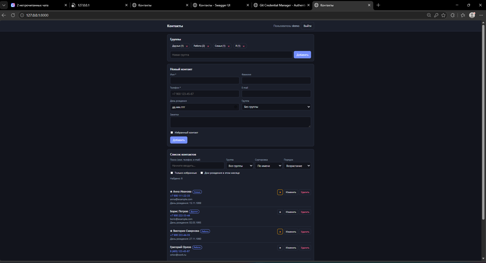
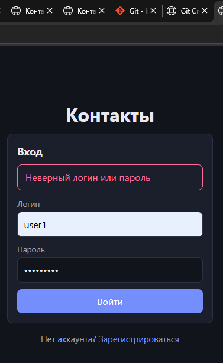
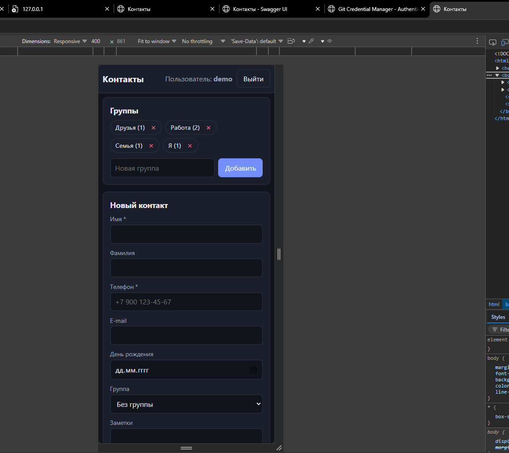

# Контакты

Учебная практика, вариант 14 «Контакты» (сущности: Контакт, Группа).

- **Студент:** Махмадуллоев Давлат
- **Группа:** ИСИП1-9-24

Пользователь регистрируется, входит и работает со своими контактами и группами: поиск по имени и телефону, фильтр по группе, сортировка, дни рождения в этом месяце.

## Запуск

```bash
python -m venv venv
venv\Scripts\activate          # Linux/Mac: source venv/bin/activate
pip install -r requirements.txt
alembic upgrade head
uvicorn app.main:app --reload
```

Сайт: http://127.0.0.1:8000 · Swagger: http://127.0.0.1:8000/docs

## Схема БД

```
users    (id, username UNIQUE, password_hash)
groups   (id, name, owner_id -> users.id)
contacts (id, owner_id -> users.id, group_id -> groups.id NULL,
          name, phone, email, birthday, is_favorite, created_at)
```

Один пользователь — много групп и много контактов. Одна группа — много контактов.

## Эндпоинты

Все, кроме регистрации и входа, требуют входа (иначе 401). Чужая запись — 404.

| Метод | URL | Назначение | Коды |
|---|---|---|---|
| POST | /api/auth/register | регистрация | 201, 409, 422 |
| POST | /api/auth/login | вход | 200, 401, 422 |
| POST | /api/auth/logout | выход | 204 |
| GET | /api/auth/me | текущий пользователь | 200, 401 |
| GET | /api/groups | группы и число контактов (group_by) | 200, 401 |
| POST | /api/groups | создать группу | 201, 401, 422 |
| DELETE | /api/groups/{id} | удалить группу | 204, 401, 404 |
| GET | /api/contacts | список: q, group_id, birthday_this_month, sort, limit, offset | 200, 401, 422 |
| GET | /api/contacts/{id} | один контакт | 200, 401, 404 |
| POST | /api/contacts | создать | 201, 401, 404, 422 |
| PATCH | /api/contacts/{id} | изменить | 200, 401, 404, 422 |
| DELETE | /api/contacts/{id} | удалить | 204, 401, 404 |

## Скриншоты




